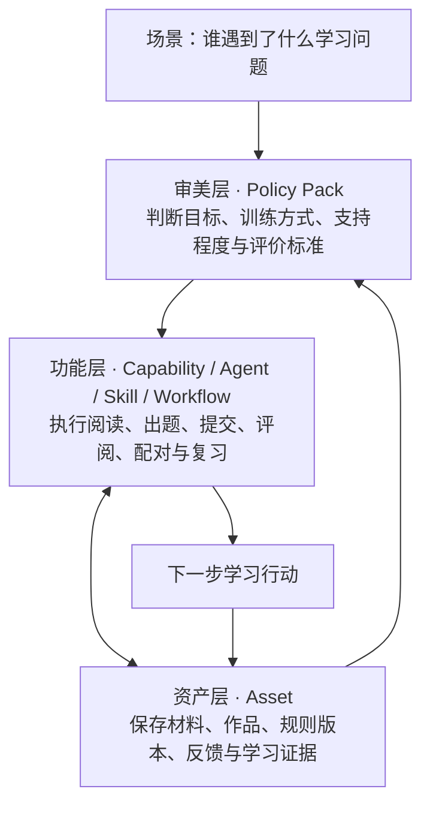

# Hyper Evolution · 超维成长

**把学习目标变成下一步行动，让每一次练习、反馈和复习接得起来。**

Hyper Evolution 是一套运行在个人电脑上的开源学习工作台。老师可以了解学生、制定规划、准备练习和评阅作业；学生可以跟随老师完成任务；自学者也可以围绕自己的资料，走完阅读、提问、练习、反馈与复习的过程。

你可以直接在浏览器里使用，也可以让自己的 Agent 通过本地 MCP 操作同一份学习工作区。网页里的 AI 使用你自己配置的模型 API。

Local-first learning for teachers, students and self-learners — with a browser workspace, your own model API, and local MCP tools.

**当前发布：v0.6.0-rc.1 工程测试版 · Windows 10/11 x64。** 欢迎带着真实使用问题来测试和共建。版本记录、安装包与校验文件见 [Releases](https://github.com/MkaliezZ/Hyper-Evolution/releases)。

## 先选适合你的版本

三个版本使用同一套内核，分别整理了适合自己的入口和操作顺序。

| 版本 | 适合谁 | 从哪里开始 | 下载 |
| --- | --- | --- | --- |
| **Enlighter · 教师版** | 教师、辅导者 | 连接学生 → 了解现状与目标 → 布置任务 → 查看作品与反馈 | [Windows 工程测试包](https://github.com/MkaliezZ/Hyper-Evolution/releases/download/v0.6.0-rc.1/Hyper-Evolution-Enlighter-Windows-x64-v0.6.0-rc.1.zip) |
| **Evolver · 学生版** | 跟随老师学习的学生 | 输入配对码 → 领取任务 → 完成并提交 → 根据反馈修订 | [Windows 工程测试包](https://github.com/MkaliezZ/Hyper-Evolution/releases/download/v0.6.0-rc.1/Hyper-Evolution-Evolver-Windows-x64-v0.6.0-rc.1.zip) |
| **Self-Evolver · 自学版** | 自主学习者 | 导入自己的资料 → 阅读与提问 → 练习 → 反馈与复习 | [Windows 工程测试包](https://github.com/MkaliezZ/Hyper-Evolution/releases/download/v0.6.0-rc.1/Hyper-Evolution-Self-Evolver-Windows-x64-v0.6.0-rc.1.zip) |

## 从这里开始

1. 下载对应版本，将压缩包**完整解压**到一个文件夹。
2. 双击 `启动-Enlighter.cmd`、`启动-Evolver.cmd` 或 `启动-Self-Evolver.cmd`。首次启动联网自动准备 Python 与依赖，随后在本机浏览器打开工作台。
3. 按向导确认身份、填写称呼、选择学科与路线。
4. 进入“连接与设置 → 模型与本机设置”，填写服务商、接口地址、模型名称和自己的 API Key，点击连接测试。
5. 老师先连接一位学生并布置任务；学生打开“我的任务”；自学者先导入一段短资料，完成一次阅读和练习。

第一次打开会先下载运行环境，耗时随网络速度变化；保留启动窗口，准备完成后浏览器会自动打开。以后再启动会直接使用已准备好的环境。

也可以先完成身份设置，浏览原创示例，再配置模型。连接测试会向所选服务商发送一次小请求，使用该账户的 API 额度。

第一次使用可跟着这几份教程走：[安装与 API 配置](docs/getting-started.md) · [教师版](docs/enlighter.md) · [学生版](docs/evolver.md) · [自学版](docs/self-evolver.md)。工作台的“使用指南”里还有按按钮展开的操作说明。

## 一次学习是怎样连起来的

**师生学习：** 老师了解学生的现状与目标，选择材料、练习方式和评价标准，布置任务。学生完成并提交作品，老师结合 AI 预审进行修改和评阅，再把反馈发给学生。学生修订、复习，并通过下一次任务继续练习。

**自主学习：** 从自己关心的问题或一份资料开始，阅读、提问、做一次有明确目标的练习，再根据反馈修改作品，把需要巩固的内容加入复习。

“投石问路 · 成长与目标”帮助老师梳理学生的现状、方向、目标要求和下一步行动；学生在自己的入口查看老师分享的规划。

## 我们为什么采用三层架构

一份材料可以有许多种学法。真正影响体验的，是判断当前该练什么、怎样练，以及练完之后看什么。因此，我们把专业判断、实际执行和可积累的内容分别组织，再让它们协同工作。



| 层 | 负责什么 | 代码入口 |
| --- | --- | --- |
| **审美层** | 将教师经验写成可复用的判断方法：识别困难、选择训练、安排帮助、检查作品、设计复测 | [`aesthetic/`](src/base/app/companion/aesthetic/) |
| **功能层** | 通过统一能力契约执行任务，处理身份、权限、模型调用和工作流；网页与 MCP 共用这些能力 | [`functional/`](src/base/app/companion/functional/) |
| **资产层** | 管理原件、来源、版本、作品和证据引用，使后续学习能接着已有积累继续 | [`assets/`](src/base/app/companion/assets/) |

例如，修辞目的题可以采用连线练习；听力可能需要辨音、定位和复述；写作可能需要论证结构训练。Policy Pack 负责判断场景与练法怎样匹配，功能层把练习执行出来，资产层保存材料、作品和反馈，供下一次判断使用。

开发者可以从 [架构与扩展指南](docs/development.md) 继续了解六对象、能力契约和模块接入。

## 现在可以做什么

- **学习与教学：** 学生档案、成长规划、材料阅读与提问、个性化练习、任务提交、写作修订、AI 预审、人工评阅、学习札记和复习安排。
- **英语路线：** K12 英语与留学英语，包含托福、雅思相关练习场景。具体材料由使用者导入，题目可以先审校、再分配。
- **其他学习领域：** 独立的学科工作区、文字与图片资料、通用活动和作品记录。教师和开发者可以补充相应的专业规则与示例。
- **本机与 Agent：** 本地 HTML 工作台、stdio / HTTP MCP、自有模型 API、师生配对、分学科存储和加密恢复包。

本轮重点验证三个入口的工程闭环。完整官方模考、自动口语评分和长期教学试用列在 [后续计划](ROADMAP.md) 中。

## 数据和模型额度

学习资料、作品和记录保存在使用者的电脑上，各学科使用独立文件夹与数据库。三个发行版也各有默认数据目录，便于在同一台电脑分别体验。

网页 AI 使用你填写的 API Key；外部 Agent 使用它自己的模型配置。调用云端模型时，完成本次任务所需的内容会发送给该模型服务商。选择记住密钥后，Windows 版本使用系统凭据管理器保存。

师生配对后，明确分享的任务、作品和反馈会在双方电脑保存副本。跨网络连接通过连接服务协商，必要时经 TURN 中转；服务可观察连接 IP、时间与流量等元数据。连接服务支持自部署，详见 [连接服务说明](docs/network.md)。

## 让你的 Agent 连接 MCP

先运行对应版本，在“连接与设置 → 模型与本机设置”复制**本机生成的 MCP 配置**，粘贴到支持 MCP 的 Agent 中。工程包准备好的 Python 运行环境提供 stdio 入口；运行中的网页服务也提供经本机凭据认证的 HTTP MCP。

Agent 与网页使用同一个身份、学科和数据目录。教师 Agent 从 [`docs/usage/teacher-agent.md`](docs/usage/teacher-agent.md) 开始，通用连接步骤见 [MCP 教程](docs/mcp.md)。

## 从源码运行

推荐使用 Python 3.11 和独立虚拟环境。下面是 Windows PowerShell 的步骤：

```powershell
git clone https://github.com/MkaliezZ/Hyper-Evolution.git
cd Hyper-Evolution
python -m venv .venv
.\.venv\Scripts\python.exe -m pip install -r requirements-local.lock
$env:PYTHONPATH = "$PWD/src"
.\.venv\Scripts\python.exe -m growth_local --edition self
```

`--edition teacher` 打开教师版，`--edition student` 打开学生版，`--edition self` 打开自学版。`--data` 可以指定自己的数据目录。Windows 在线安装工程包已进行本机验证；其他平台可参考 [源码开发说明](docs/development.md) 配置系统密钥库。

## 一起共建

欢迎提交使用反馈、修复问题、补充教学案例，或为新的学习场景编写 Policy Pack。我们希望教师经验能沉淀成清楚的方法，让开发者按照统一契约接入自己的实现。

开始前请读 [贡献指南](CONTRIBUTING.md)。报告使用问题时，请附上版本、操作步骤和经过脱敏的截图；安全问题通过 [安全反馈渠道](SECURITY.md) 提交。

## 许可与致谢

项目源码采用 [MIT License](LICENSE)。伴学 BASE 提供了基础教学闭环；部分来源绑定评估与自学流程借鉴 [HKUDS/DeepTutor](https://github.com/HKUDS/DeepTutor)，相关出处和 Apache-2.0 许可保存在 [`third_party/deeptutor/`](third_party/deeptutor/)。

依赖清单、内容授权范围及发行包的许可材料见 [第三方说明](THIRD_PARTY_NOTICES.md)。公开示例使用原创内容；使用者导入的教材、题库、音频和作品按照各自授权管理。
